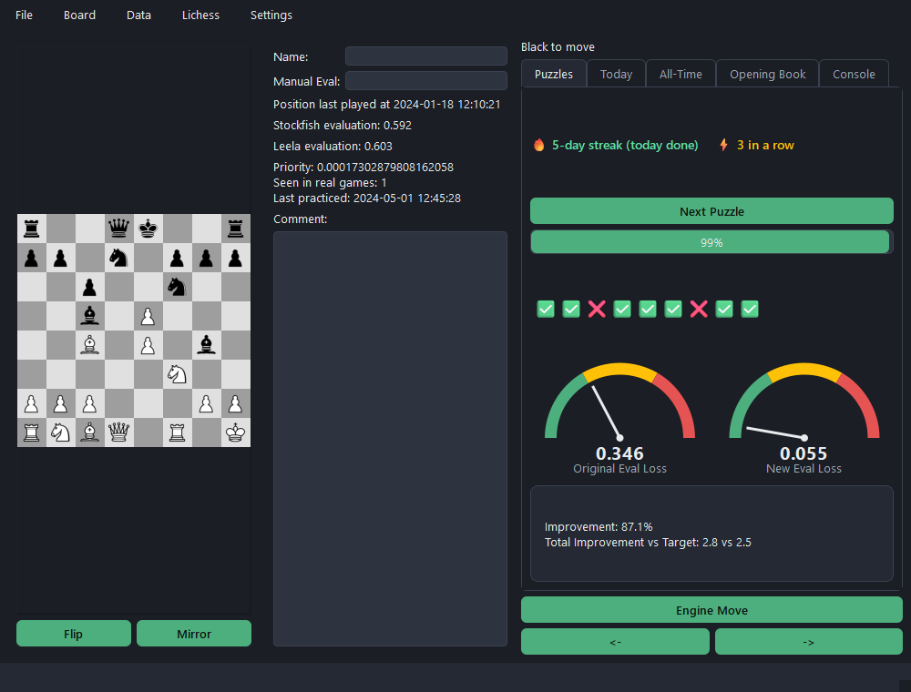

# ♟️ Sensei

**Sensei turns your own chess games into your own puzzle set.**

Instead of training on generic tactics, Sensei imports your games from Lichess,
finds the moves where you (or your opponents) lost the most evaluation, and
turns those exact positions into a spaced-repetition puzzle queue - prioritised
by how costly the mistake was, how often the position has come up, and how
long it's been since you last saw it. Every attempt is scored by Stockfish and
Leela running in the background, so the app never freezes while you think.



## Features

- **Puzzles from your own games** - every puzzle comes from a real position
  you've actually played, not a generic tactics database.
- **Priority-based spaced repetition** - puzzles are re-surfaced based on a
  blend of mistake size, recency, and how often the position has occurred in
  your real games, so practice time goes where it matters most.
- **Two-engine evaluation** - Stockfish and Leela Chess Zero are run and
  alternated so puzzle quality isn't biased by either engine's blind spots.
- **Game review mode** - replay an imported game move by move and see where
  it diverged from the engine's recommendation.
- **Retry failed puzzles** on the spot, from the result popup.
- **Session gamification** - a per-puzzle ticket row, a solve streak counter,
  a daily practice streak, and milestone badges for consistent practice.
- **Interesting metrics!** see stats from individual games or your entire history. Performance by time control etc. **See your best ever games!**
- **Opening book / position notes** - name positions, leave comments, and set
  a manual evaluation that overrides the engines where you disagree with them.

## Getting started

### 1. Install dependencies

```bash
pip install -r requirements.txt
```

Requires chess engines of your own:
- [Stockfish](https://stockfishchess.org/download/)
- [Leela Chess Zero](https://lczero.org/play/download/) (with a network file)

### 2. Configure engine paths

Run the app once (`python main.py`) and the Settings dialog will prompt for
the Stockfish/Leela executable paths and puzzle-generation depth/node
settings the first time they're needed. They're saved locally to
`EasyChessGuiSettings.json`, which is gitignored - never committed.

### 3. (Optional) connect your Lichess account

Set an environment variable with a [Lichess personal API token](https://lichess.org/account/oauth/token)
to download your own games and query rate-limited endpoints:

```bash
export LICHESS_API_KEY=lip_your_token_here
export CHESS_USERNAME=your_lichess_username
```

Both are optional - you can also import .pgn files to the apps database.

### 4. Run it

```bash
python main.py
```

Use **File → Build Puzzles** to generate your initial puzzle set from
imported games, then **Puzzles → Next Puzzle** to start training.

## Running tests

```bash
pytest tests/
```

## Project layout

```
gui/              PySide6 UI: main window, board, popups, background eval worker
utils/            Core logic: database, engines, scoring, puzzle selection
tests/            pytest suite
main.py           Entry point
```

The database (`chess_database.db`, SQLite) is created automatically on first
run and is entirely local - your games and puzzle history never leave your
machine except for the Lichess API calls you explicitly make.

## Tech stack

[python-chess](https://python-chess.readthedocs.io/) for move generation and
engine communication, [PySide6](https://doc.qt.io/qtforpython-6/) for the UI,
SQLite for storage, and [berserk](https://github.com/lichess-org/berserk) for
the Lichess API.
